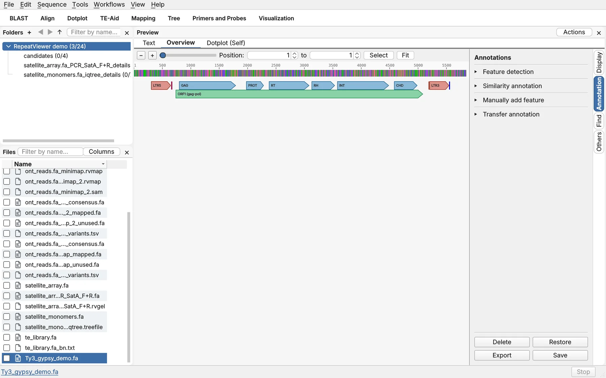

# RepeatViewer

RepeatViewer is a cross-platform desktop application for **inspecting, annotating, curating, and visualizing** 
repetitive DNAs, especially transposable elements (TEs). It works on Linux, macOS, and Windows.


RepeatViewer is developed by Jiangzhao Qian and [Abdullah EI-nagish](https://github.com/aelnagish)


<p align="center">
  <a href="https://aelnagish.github.io/RepeatViewer/"><b>Website</b></a> ·
  <a href="#installation"><b>Install</b></a> ·
  <a href="docs/manual/"><b>User manual</b></a>
</p>

<p align="center">
  
</p>

---

**Main features**

- Detect TE structural features (LTRs, TIRs, tandem repeats) and ORFs interactively
- Search user-defined protein, DNA, and HMM databases (e.g. Pfam, Dfam, REXdb, Repbase, CDD)
- Edit annotations visually and export GFF
- Run a one-click (or custom) consensus curation workflow
- Visualize TE sequences and genome-wide annotations (dot plots, abundance, divergence, density)
- Extend the app with plugins, command wrappers, and workflows

---

## Installation

### Prebuilt packages

Choose according to your platform. Links below point to **v1.2.0** from [Releases](https://github.com/qjiangzhao/RepeatViewer/releases) page.

| Platform | Download |
|----------|----------|
| **macOS** (Apple Silicon) | [RepeatViewer-1.2.0-macos-arm64.dmg](https://github.com/qjiangzhao/RepeatViewer/releases/download/v1.2.0/RepeatViewer-1.2.0-macos-arm64.dmg) |
| **macOS** (Intel) | [RepeatViewer-1.2.0-macos-x86_64.dmg](https://github.com/qjiangzhao/RepeatViewer/releases/download/v1.2.0/RepeatViewer-1.2.0-macos-x86_64.dmg) |
| **Windows** (64-bit) | [RepeatViewer-1.2.0-windows-x64.zip](https://github.com/qjiangzhao/RepeatViewer/releases/download/v1.2.0/RepeatViewer-1.2.0-windows-x64.zip) |
| **Linux** (x86_64) | [RepeatViewer-1.2.0-linux-x86_64.tar.gz](https://github.com/qjiangzhao/RepeatViewer/releases/download/v1.2.0/RepeatViewer-1.2.0-linux-x86_64.tar.gz) |

- **macOS:** open the `.dmg`, drag RepeatViewer to Applications, then launch it.
- **Windows:** unzip the archive and run `RepeatViewer.exe` (or the app shortcut inside).
- **Linux:** unpack the `.tar.gz` and run the `RepeatViewer` binary from the extracted folder.

---

### Install from source

**Requirements:** Python **3.10 or later** (only for this path).

Use this when you want to develop RepeatViewer or prefer a conda/pip install.
Get the source from Releases (**Source code** zip/tar.gz) or clone the repo, then
follow the platform steps below.

#### macOS and Linux

**1. Get the source (pick one)**

**Option A — Download from Releases**

1. Open [github.com/qjiangzhao/RepeatViewer/releases](https://github.com/qjiangzhao/RepeatViewer/releases)
2. Open the latest release (for example **v1.2.0**)
3. Under **Assets**, download **Source code (zip)** or **Source code (tar.gz)**
4. Unpack the archive and open a Terminal in that folder

```bash
# Example after downloading Source code (zip) for v1.2.0:
cd ~/Downloads/RepeatViewer-v1.2.0   # folder name matches the release tag
```

**Option B — Clone with git**

```bash
git clone https://github.com/qjiangzhao/RepeatViewer.git
cd RepeatViewer
```

**2. Create an environment and install**

```bash
# Create and activate a conda environment (Python 3.10 or newer)
conda create -n repeatviewer "python>=3.10" -y
conda activate repeatviewer

# Install RepeatViewer from the unpacked / cloned source
pip install -e .
```

**Run:**

```bash
conda activate repeatviewer
repeatviewer
```
Or from the repository root: `python RepeatViewer.py`.

**Optional RepeatMasker and FastGA** (only if you need those features, e.g.
Repeat Quantify or FastGA alignment):

```bash
conda activate repeatviewer
conda install -c bioconda -c conda-forge repeatmasker fastga -y
```

Then point RepeatViewer at this environment under
**File → Setting → External tools (conda)** (env name `repeatviewer`, or the
full path to the env).

---

#### Windows (from source)

Install with **native Windows Python** (not inside WSL). Use **PowerShell**
(Start → `PowerShell`, or Windows Terminal → PowerShell; not Command Prompt / WSL).
Place the source in a user-writable folder such as `Documents`, not under
`C:\Program Files`.

**1. Prerequisites**

- [Python 3.10 or later](https://www.python.org/downloads/) for Windows, from **python.org**.
  During setup, keep **"py launcher"** ticked and enable **"Add python.exe to PATH"**.
  Other Pythons on the same computer (from Rtools, MSYS2, Git for Windows, Cygwin) do not work:
  they create environments without a `Scripts` folder, and PySide6 cannot be installed in them.
  The steps below use the `py` launcher, which always picks a python.org Python.
- Microsoft Visual Studio Build Tools with the C++ workload are required to install orfipy, which is used as a dependency by this repository.
  The required build tools can be installed from a PowerShell terminal using:
  ```powershell
  winget install -e --id Microsoft.VisualStudio.BuildTools --override "--passive --wait --add Microsoft.VisualStudio.Workload.VCTools --includeRecommended"
  ```

**2. Download the source from Releases**

1. Open [github.com/qjiangzhao/RepeatViewer/releases](https://github.com/qjiangzhao/RepeatViewer/releases)
2. Open the latest release
3. Under **Assets**, download **Source code (zip)**
4. Unzip the archive (e.g. to `Documents`). You should get a folder such as
   `RepeatViewer-v1.2.0` (the name matches the release tag)

Alternatively, from the repo home page use the green **Code** → **Download ZIP**
button (folder name will look like `RepeatViewer-main`).

**3. Open PowerShell in that folder**

Adjust the path if you unzipped somewhere else:

```powershell
cd $HOME\Documents\RepeatViewer-v1.2.0
```

Confirm you are in the right place (`RepeatViewer.py` and a `repeatviewer` folder should be listed):

```powershell
dir
```

Check that a python.org Python is available (this lists every Python the launcher can use):

```powershell
py -0p
```

If the command is not found or the list is empty, install Python from python.org first (step 1).

**4. Create a virtual environment and install with pip**

Always create a **virtual environment** first. It is the same idea as a named
conda env (`conda create -n ...`): an isolated place for packages. With venv, that
"name" is simply a **folder** next to the project, here `.venv`.

> **Do not name the environment `repeatviewer`.** The project already has a folder
> called `repeatviewer` that holds the program code. A venv with that name is written
> into the code folder, and deleting it deletes RepeatViewer itself.

Create the environment:

```powershell
py -3 -m venv .venv
```

Check it. This must print `win-amd64` (or `win-arm64`):

```powershell
.\.venv\Scripts\python.exe -c "import sysconfig; print(sysconfig.get_platform())"
```

If PowerShell says `.venv\Scripts\python.exe` does not exist, the environment was made by a
non-Windows Python (see step 1). Remove only the `.venv` folder (`Remove-Item -Recurse -Force .venv`),
install Python from python.org, and try again.

Install RepeatViewer:

```powershell
.\.venv\Scripts\python.exe -m pip install -U pip
.\.venv\Scripts\python.exe -m pip install -e .
```

**Run**:

```powershell
.\.venv\Scripts\python.exe RepeatViewer.py
```

These commands call the environment's Python directly, so no activation is needed.
If you prefer to activate it (then `repeatviewer` alone starts the app):

```powershell
.\.venv\Scripts\Activate.ps1
repeatviewer
```

If PowerShell blocks script activation, run once:

```powershell
Set-ExecutionPolicy -Scope CurrentUser RemoteSigned
```

Each new PowerShell session starts in your home folder: `cd` into the RepeatViewer folder again
(step 3), then run or activate as above.

**5. Optional — WSL2 + conda for RepeatMasker and FastGA**

This step is **optional**. Core RepeatViewer features (browse, annotate, BLAST,
align with bundled tools, most plots) work without it. Install WSL2 only if you
want **extra** Linux-only tools such as RepeatMasker and FastGA.

1. Install [WSL2](https://learn.microsoft.com/windows/wsl/install) (e.g. Ubuntu).
2. Inside the **WSL** terminal, install conda/mamba, then:

   ```bash
   conda create -n repeatviewer "python>=3.10" -y
   conda activate repeatviewer
   
   # Add the tools you need
   conda install -c bioconda -c conda-forge repeatmasker fastga -y
   ```

3. In RepeatViewer (the Windows app): **File → Setting → External tools (conda / WSL2)**
   → set `repeatviewer` (or the full path to that WSL env, e.g.
   `~/miniconda3/envs/repeatviewer`).
4. Click **Test** — status should show that WSL2 conda is used.

---

## Quick start

1. **Get example data** — download the TEtrimmer test files from
   [github.com/qjiangzhao/TEtrimmer/tree/main/tests](https://github.com/qjiangzhao/TEtrimmer/tree/main/tests)
   (use **Download raw file** for individual FASTAs, or clone/download the TEtrimmer
   repository ZIP and open the `tests` folder).
2. **Import the folder** — in RepeatViewer, drag the downloaded `tests` folder into
   the Folders panel (or add it via the folder context menu).
3. **Select a FASTA** — click a sequence in the Files panel; Preview opens Text /
   Annotation / Dotplot tabs.
4. **Define genome** — **File → Define genome** (single FASTA or pan-genome list)
   when you need BLAST or genome plots.
5. **Annotate** — run Auto annotation and/or Similarity annotation; edit features on
   the Annotation tab; **Save**.
6. **Curate** — run BLAST / Extend / Align / MSA clean / Consensus, or a saved workflow.
7. **Visualize** — Flexidot, TE abundance, divergence, density, or TE-Aid as needed.

Background jobs show progress in the status bar; **Stop** cancels the active task.

---

## Interface overview

| Panel | Purpose |
|-------|---------|
| **Folders** | Workspace roots and subfolders; back / forward / up; filter by name |
| **Files** | Sortable table (name, length, GC%, sequence count); multi-select; context actions |
| **Preview** | FASTA (Text · Annotation · Dotplot), HTML reports, alignments, PDFs, images |

---

## Documentation

| Guide | Contents |
|-------|----------|
| [User Manual](docs/manual/) | Illustrated manual: every tool, window and output ([PDF](docs/manual/RepeatViewer_User_Manual.pdf)); also under Help in the app |
| [Plugins](docs/PLUGINS.md) | Extending RepeatViewer with plugins |

---

## Citation

If you use RepeatViewer, please cite:

> Qian J, El-nagish A, Szatkowski S, Maiwald S, Sultana N, Costard D, Rudzinski A, Schmidt N, Heitkam T. 2026. RepeatViewer: a platform for explorative analysis of repetitive DNAs. bioRxiv, https://doi.org/10.64898/2026.11.23.768287

---

## Project structure

```
RepeatViewer/
  RepeatViewer.py          # entry script
  repeatviewer/
    main_window.py         # browser UI, menus, job runner
    project.py             # genome, pan-genome, database settings
    backends/              # analysis engines (BLAST, TE-Aid, Flexidot, …)
    views/                 # tool and settings dialogs
    widgets/               # folder tree, file table, preview tabs
    plugins/               # plugin API
  docs/                    # user manual
  packaging/               # optional native package build scripts
  examples/                # sample plugin
```

---

**Recommended pairing:**
generate libraries with [TEtrimmer](https://github.com/qjiangzhao/TEtrimmer), then inspect and refine them in
RepeatViewer.

**Citation**


**Authors:** 
Jiangzhao Qian, Abdullah El-nagish, Shlok Szatkowski, Sophie Maiwald, Nusrat Sultana, Daniel Costard, Anna Rudzinski, Nicola Schmidt, Tony Heitkam 

