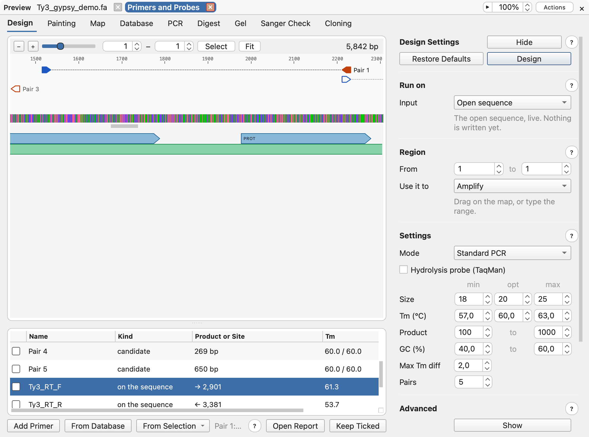
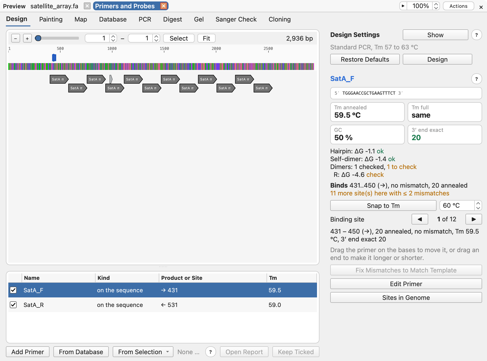
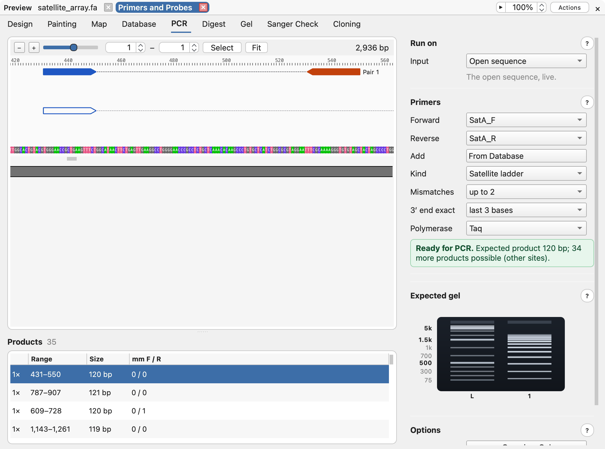
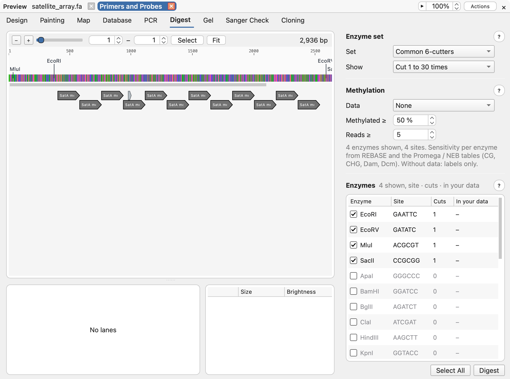
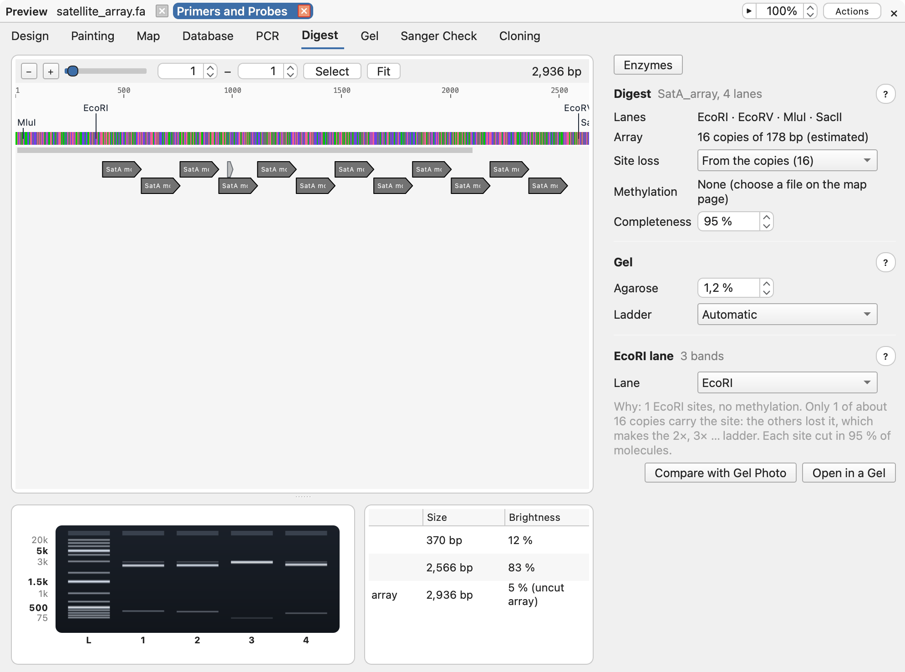
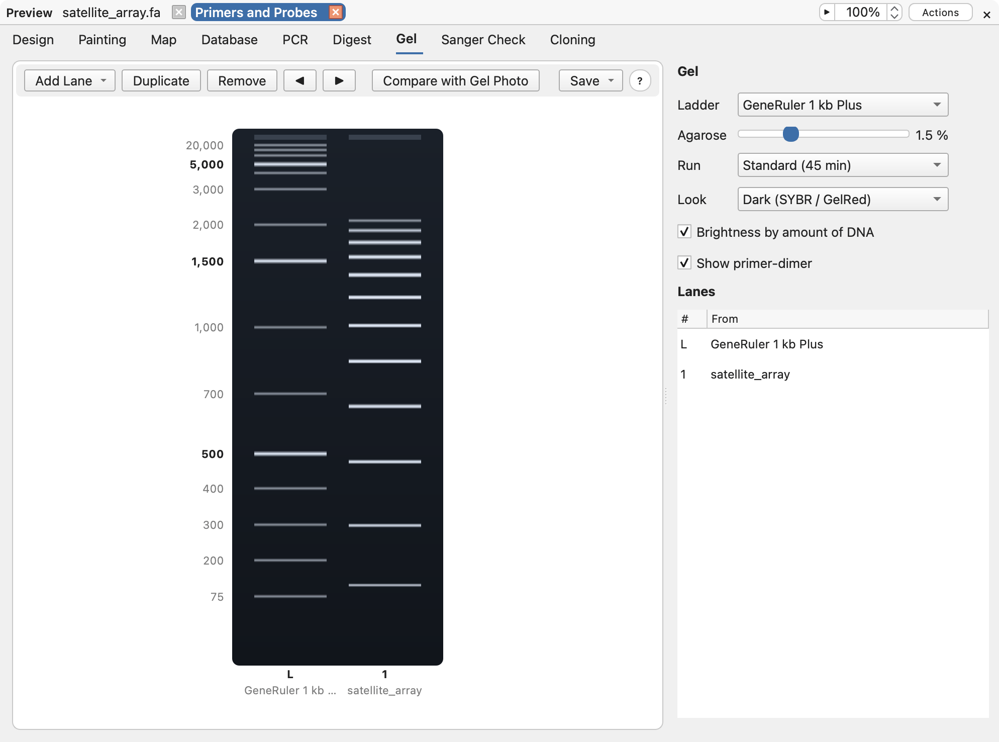
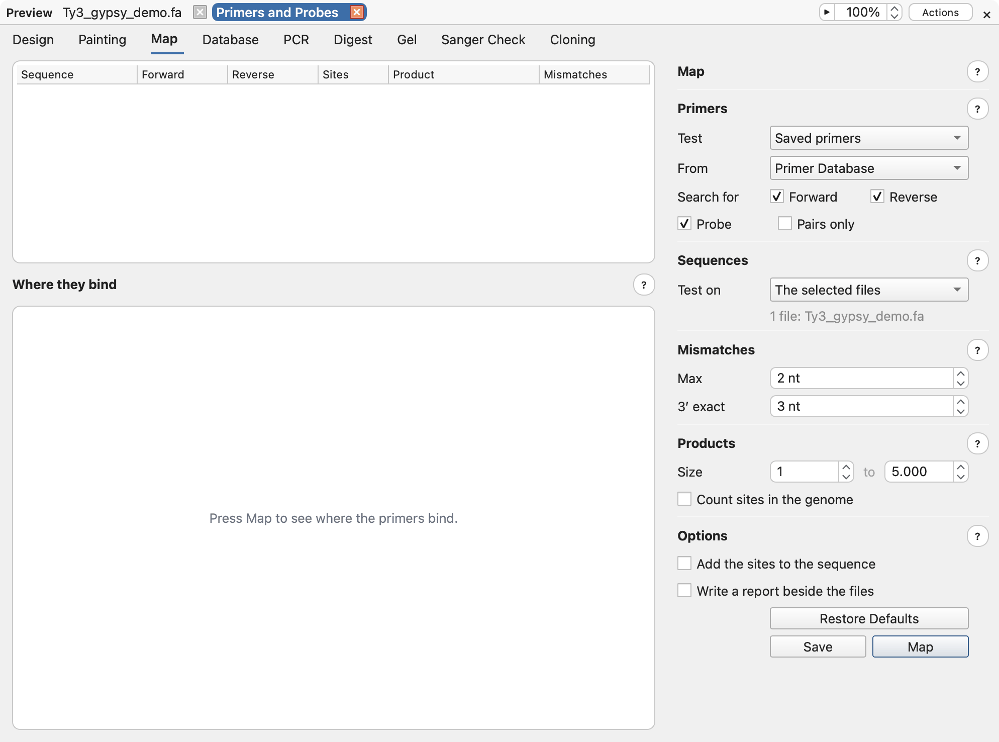
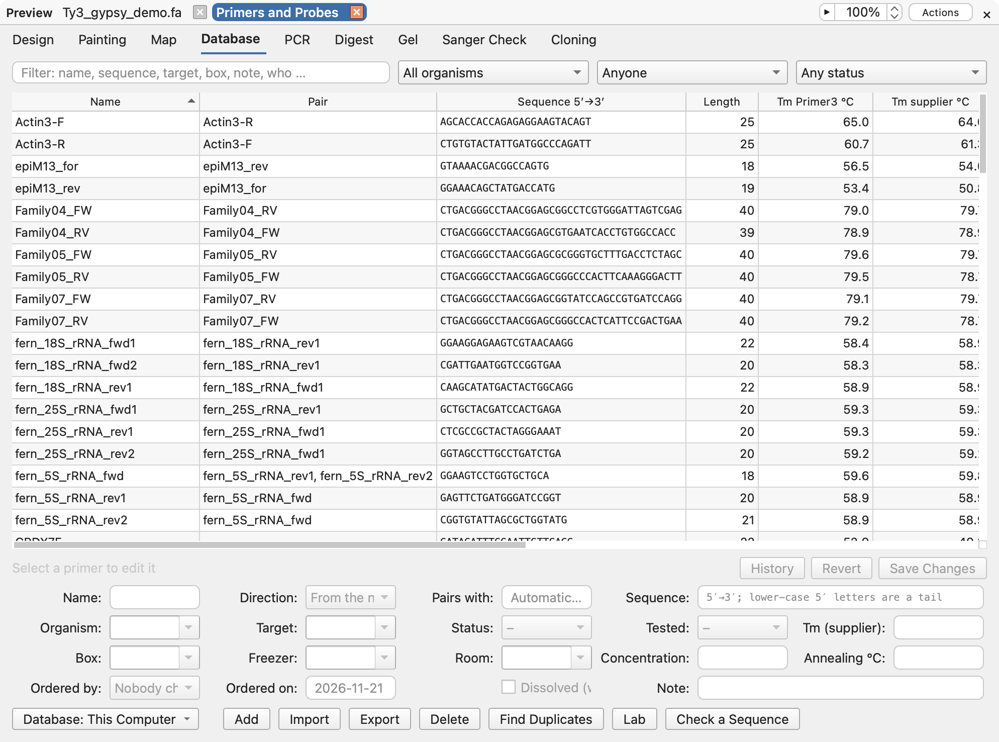
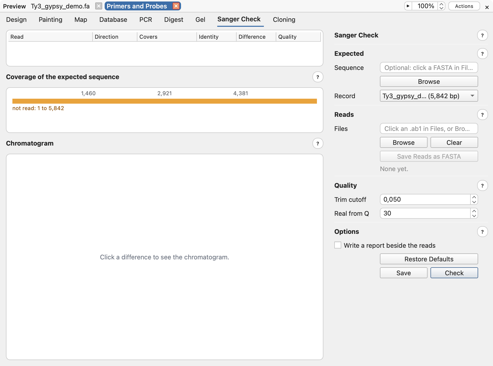
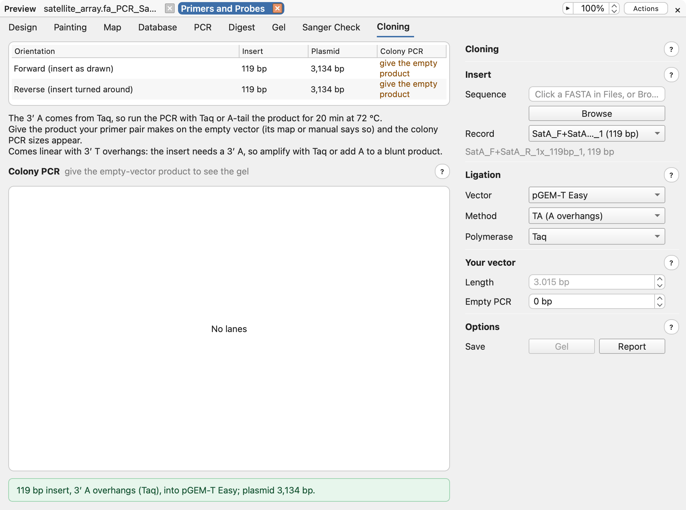

# Primers and PCR

RepeatViewer designs PCR primers and FISH probes for repeats, shows primers on
the sequence, runs in-silico PCR, draws the expected gel, and keeps the lab's
primer inventory. Everything runs on your computer; nothing is sent online.

| Where | What |
|-------|------|
| **Tools → Primers and Probes → Design** | Design primers (**Primers**), FISH probes for a repeat (**Repetitive Probes**) or painting probes (**Chromosome Painting Probes**) |
| **Tools → Primers and Probes → Map** | Test primers or probes against sequences, like Geneious' *Map Primers* |
| **Tools → Primers and Probes → Database** | The lab's primer inventory |
| **Tools → Primers and Probes → In-silico PCR**, **Restriction Digest**, **Gel** | The products of a PCR, a digest of the sequence, the expected gel |
| **Tools → Primers and Probes → Sanger Check**, **Cloning** | Check a clone against its Sanger reads; plan putting a product into a vector |

Every item opens the same tab, **Primers and Probes**, on the matching section.

The toolbar can also show a **Primers and Probes** button (**File → Setting →
Toolbar → Add buttons…**). It offers the same items; right-click designs with
the saved settings.

## Quick start

1. Click the FASTA you want primers for in the Files panel.
2. Choose **Tools → Primers and Probes → Design → Primers**. The **Primers and
   Probes** tab opens on the **Design** section, with your sequence.
3. Drag on the map over the part to amplify, keep **Mode** on *Standard PCR*
   and click **Design**.
4. The candidate pairs appear in the list under the map and as arrows above the
   sequence. Tick the pairs you want and click **Keep Ticked**: their primers
   are now on the sequence.
5. Click the **PCR** section to see the products of the ticked primers and the
   expected gel.

## The workspace

**Primers and Probes** is one tab. The row on top holds its sections: **Design**,
**Painting**, **Map**, **Database**, **PCR**, **Digest**, **Gel**, **Sanger
Check** and **Cloning**. A section keeps what you did in it while you look at
another one.



**Design**, **PCR** and **Digest** work on one sequence:

- Click a FASTA's name in the Files panel to work on it. Ticking a file's box
  does not change it. For a file that holds several sequences, **Record** in
  the Position row chooses the one to work on.
- The **map** shows the sequence. What a section adds is drawn in rows of its
  own above the bases, so no letter is covered: enzyme names, one row for each
  candidate pair, and the primer you are editing. A region you chose is a light
  tint behind them.
- The **list under the map** holds what Design found (*candidate*) and the
  primers already on the sequence (*on the sequence*); in **PCR** it holds the
  products. Drag the border between the map and the list to give one of them
  more room.
- The **panel on the right** holds the settings of the section.

The other sections are whole pages of their own. **Map** and **Database** open
without a sequence.

> **Tip.** A path field in the panel (for example *Avoid file*) is filled by a
> click in the Files panel: put the cursor in the field first, then click the
> file. To open a file in a tab of its own while the workspace is in front,
> right-click it and choose **Open in Additional Tab**.

## Design

The settings are in the panel on the right of the **Design** section.

**Run on**: **Open sequence** designs on the open sequence. The candidates appear in
the list under the map and nothing is written until you press **Keep Ticked**
or **Open Report**. **Selected files** runs the design as a job on every FASTA
ticked in the Files panel and writes the report files beside them, with the
same settings.

**Mode** is the kind of design. Changing it loads sensible starting values
(size, Tm, product size); **Restore Defaults** brings them back.

| Mode | Use it for | Template | You get |
|------|------------|----------|---------|
| Standard PCR | An ordinary pair | Any sequence | Ranked pairs and a virtual gel |
| qPCR | Quantitative PCR | The target; optionally a single-copy reference gene FASTA | Short amplicons (70 to 180 bp), an optional TaqMan probe, and a matched pair on the reference gene for ΔCt |
| Ladder PCR | Showing that a satellite sits in tandem arrays | Monomers (one or many) | Outward-facing primers inside one monomer. On genomic DNA they give a ladder: 1×, 2×, 3× … the monomer |
| Satellite repeat oligos | FISH probes for a satellite or repeat family | Monomers or copies, or a TAREAN dimer consensus | 35 to 60 nt oligos present in at least *Min coverage* of the copies, without hairpins, with a Tm for your hybridisation conditions, ready to order with a 5′ label (FAM, Cy3, Cy5 …) |
| Chromosome painting (Chorus2) | Oligo pools that paint whole chromosomes or regions | The genome FASTA | Thousands of single-copy 45 nt oligos along the chromosomes, an order file and a density plot (see below) |

For ladder PCR and FISH oligos, use many monomers (for example extracted from an
array) rather than one: the tool then keeps the parts shared by most copies. A
dimer consensus (TAREAN's `consensus_dimer.fasta`, the monomer written twice) is
recognised and cut back to one monomer.

**Satellite repeat oligos** have their own settings:

| Field | Meaning |
|---|---|
| Avoid the other selected files | Select the target family first, then the other families (one FASTA each). Probes are designed on the first file and every probe that matches the others is ranked last; the report names the sequences it matches |
| Leave out low-complexity and inverted repeats | Low-complexity stretches (DUST, as `dustmasker -level 30`), simple repeats and inverted repeats (arms of 12 nt or more, as EMBOSS `einverted`) are found first and no probe may touch them; the report lists them |
| Hybridisation | Formamide, SSC and temperature of the hybridisation (default 50 % formamide, 2× SSC, 37 °C) |
| Stringent wash | The same for the stringent wash (default 20 % formamide, 0.1× SSC, 42 °C); probes that would melt off in it are not offered |
| Probe | Probe concentration in the mix (default 100 nM) |

For these probes **Tm** is the Tm under the hybridisation conditions, not in a
PCR buffer: SantaLucia (1998) nearest-neighbour values with the Owczarzy et al.
(2004) Na⁺ correction (1× SSC = 195 mM Na⁺), minus 0.60 °C per % formamide
(Hutton 1977). The default window (48 to 58 °C, about 52 °C for 50 to 60 nt)
follows the TAREAN probe design protocol. The report gives each probe's Tm in
the wash and how far it stays above the wash temperature.

> **Tip.** Never use a PCR product amplified from genomic DNA as a hybridisation
> probe, even with one band of the expected size: clone and sequence it first,
> and keep short simple repeats in the clone out of the probe.

**Primer Conditions**:

| Field | Meaning |
|-------|---------|
| Primer size | Minimum, optimum and maximum length (nt) |
| Tm (°C) | Minimum, optimum and maximum melting temperature of the binding part |
| GC | Allowed GC content (%) |
| Product size | Allowed amplicon length (bp) |
| Max Tm difference | Largest Tm gap between the two primers of a pair |
| Pairs to return | How many pairs the report lists |

**Advanced Settings ▸** adds poly-X, GC clamp, 3′ stability, probe size and Tm,
5′ tails (M13, T7, restriction sites, or your own) and the Tm calculation (salt,
Mg²⁺, dNTP and oligo concentration).

**Options**: **Ask which pairs to add here** (for a run on selected files);
**Add them to the Database**. **Restore Defaults** brings the starting values
of the mode back, **Save** keeps the settings for the next time.

### Design results

Next to the input:

```
gene.fa_primers.html              the report (opens in Preview)
gene.fa_primers_details/
   gene.fa_primers_primers.fa     every primer, with order-ready names
   gene.fa_primers_pairs.tsv      table of pairs
   gene.fa_primers_gel.svg        virtual gel
   gene.fa_primers.json           all results
```

The report lists the pairs (Tm, GC, hairpin and dimer ΔG, product size, notes),
the virtual gel and a **Methods text** paragraph for a paper. When nothing is
found it explains why (for example how many primers failed on Tm or GC). Common
fixes: widen the Tm range or the product size; for satellite oligos lower *Min
coverage* or allow more mismatches.

## Design on the sequence

1. **Region**: drag on the map or the bases; the range appears in *From* and
   *to* (or type it). Choose what the region is for:
   - **Amplify**: the primers sit outside the region, one on each side, and the
     product covers all of it.
   - **Inside**: both primers and the product stay inside the region.
   - **Avoid**: no primer may sit in the region (a SNP, a methylated site, a
     repeat).

   For probes only **Inside** and **Avoid** are offered: a probe sits in the
   region or keeps out of it.
2. **Settings**: the mode, primer size, Tm, GC and product size; **Advanced**
   has the finer rules and the salt.
3. **Design**: the pairs appear in the list under the map, best first, and
   each pair gets a row of arrows above the sequence (the selected pair is
   filled, the others are outlined). Click a pair to see it; tick the ones you
   want and press **Keep Ticked**. They are added to this sequence's primers.
   Nothing is written before that. **Open Report** writes the usual primer
   report.

When the region and the settings cannot work together (for example a 1,500 bp
region to amplify with products of at most 1,000 bp), an amber note says why
before you run, and **Fit** changes the product range. Nothing is blocked: the
settings guide the automatic design, your choice wins.

## Primers on the sequence

The list under the map shows the primers kept with this FASTA as *on the
sequence*. Each is drawn as an arrow where it binds (blue: points right;
orange: points left).

- **Add Primer** types a new one, **From Database** picks saved ones.
- **From Selection** makes a primer from bases on the sequence: drag over 10 to
  60 bases on the map, then choose **Forward Primer** (the bases as they are)
  or **Reverse Primer** (their reverse complement). The primer appears on the
  sequence and can be dragged or edited like any other. When the selection
  does not fit, the note by the list says why.
- **Click** a primer to see its details in the panel on the right and jump to
  it: Tm, hairpin and self-dimer ΔG, where and how well it binds. While a
  primer is selected the design settings are folded to one line, **Design
  Settings**; **Show** opens them again. Clicking a candidate also brings them
  back.
- The details sum up the dimers with the other ticked primers in one line
  (for example *Dimers: 6 checked, all ok*) and list only the pairs to look
  at. **Show All** lists every pair, **Hide** folds the good ones away again.
  Hover the list to read the full primer names.
- The selected primer is drawn as a bar in its own row right above its bases.
  **Drag** the bar to move the primer, or drag one of its ends to make it
  longer or shorter. A base that does not match the template is red on the
  primer.
- **Snap to Tm** shortens or lengthens the primer along the template to reach a
  Tm; **Fix Mismatches to Match Template** makes it match this sequence;
  **Edit Primer** opens the primer with its tail and checks; **Sites in Genome**
  shows where it binds in a genome.
- **Right-click** a primer in the list to edit it, copy its sequence, add it to
  the Primer Database or remove it.
- The **tick** marks the primers that the **PCR** section uses.

A **tail** is the 5′ part that does not bind (lower-case letters). It is copied
into the product from cycle 3 on, so two Tm values are shown: **annealed** (the
binding part, mismatches included) and **full** (the whole oligo).

**Edit Primer** shows the primer on its best site, with mismatches in red and
matching 3′ bases in green; **Site** steps through other sites; **− +** make
either end shorter or longer along the template; **5′ tail** adds a restriction
site (with padding bases so the enzyme cuts), a sequencing or promoter tail, or
your own; and the dimer and hairpin checks give ΔG at 37 °C (below −9 kcal/mol
for dimers or −3 for hairpins is a warning).

**Sites in Genome**: each genome sequence drawn on one scale, forward sites as
ticks above the bar, reverse sites below (darker = fewer mismatches), and for
a qPCR pair the number of products per haploid genome, the value to expect in a
copy-number assay.



Primers are saved in a hidden `name.primers_RV.json` next to the FASTA and
follow it when it is renamed or moved.

## In-silico PCR

**Tools → Primers and Probes → In-silico PCR**, or the **PCR** section of the
workspace. The products are listed under the map and drawn in the expected gel
in the panel. There is no Run button: the products update by themselves when
you change anything.



The panel, from top to bottom:

| Section | What it holds |
|---------|---------------|
| **Run on** | **Input**: *Open sequence* (the sequence in the map, live) or *Selected files* (every FASTA ticked in the Files panel, so one pair can be tested on many satellite families at once; the products of all files are listed together, each with its file) |
| **Primers** | **Forward** and **Reverse**: primers on this sequence. **From Database** puts saved primers on the sequence so they can be chosen. **Kind**, **Mismatches**, **3′ end exact** and **Polymerase** set the reaction |
| **Products** | Every product the two primers make, best first: **Range**, **Size** and **mm F / R** (mismatches of the forward and the reverse primer at that site). Click a product to see it on the sequence |
| **Expected gel** | The products next to a size ladder |
| **Options** | **Open in a Gel**, **Bench Card**, **Save Products** |

- **Kind**: *Standard* lists every product. *Satellite ladder* groups the
  products that step by a monomer and labels them 1×, 2×, 3×.
- **Mismatches** (none, or up to 1 to 4 per primer) and **3′ end exact** (no
  rule, or the last 2 to 5 bases) decide which sites count. **Polymerase** sets
  how fast long products fall off.
- The **status box** under the primers says what to expect. Green: *Ready for
  PCR*, with the expected product size. Amber: the expected product is longer
  or shorter than the product range set in Design. That is allowed (the tube
  still makes it); **Set Range to … bp** changes the range in Design to fit.
  *No product* means the two primers do not face each other on this sequence.

**Open in a Gel** makes a gel document from this PCR, next to the sequence,
that you can change (lanes, agarose, ladder; see [The gel](12-primers.md#the-gel)).

**Save Products** writes, next to the sequence, `<template>_PCR_<primers>.fa`
(the products) and `…_details/` (`_products.tsv`, `_history.json`,
`_result.json`). The products file opens like any multi-FASTA, with the primer
sites and the template's features on each product.


**Bench Card**: volumes per reaction and for all reactions plus extra (template
added to each tube); annealing from the lower primer Tm (Taq 3 °C below,
Phusion or Q5 3 °C above); extension from the longest product wanted (Taq
1 min per kb, Phusion or Q5 20 s per kb); freezer places from the Primer
Database. Change the numbers on the right, then **Save PDF** or **Print**.

## Restriction digest

**Tools → Primers and Probes → Restriction Digest**, or the **Digest** section
of the workspace. The enzymes that cut the sequence are named in a row above
the bases on the map and listed in the panel.



| Section | What it holds |
|---------|---------------|
| **Enzyme set** | **Set**: which enzymes to look at. *Methylation-sensitive* holds the enzymes with known CG or CHG sensitivity (HpaII and MspI as a pair). **Show**: enzymes that cut this often are ticked and drawn on the sequence |
| **Methylation** | **Data**: a Bismark `.cov` or modkit `bedMethyl` file. **Methylated ≥** and **Reads ≥**: a site counts as blocked when a cytosine of the site is methylated at least this much, with at least this many reads, in a context that blocks the enzyme |
| **Enzymes** | The list: **Enzyme**, **Site**, **Cuts** (sites on this sequence) and **In your data** (sites probably not cut because of methylation in your file) |

- Click an enzyme to go to its first site. Tick or untick any enzyme; only the
  ticked ones are drawn and digested.
- **Select All** ticks every enzyme in the list; press it again to untick them
  all.
- With methylation data, the rows of the chromosome named like this sequence
  are read (an extracted region named *chrom:start-end* is shifted to its own
  positions). Blocked sites are drawn red and dashed: *probably not cut*.
  Without data the map shows the labels only.
- The sensitivity of each enzyme (CG, CHG, Dam, Dcm) follows the Promega and
  NEB tables and REBASE (McClelland et al. 1994). Dam and Dcm only matter for
  DNA grown in *E. coli*.

**Digest** shows the ticked enzymes as a gel, and the panel changes to the
result. **Enzymes** on top goes back to the list.



| Section | What it holds |
|---------|---------------|
| **Digest** | **Lanes**: one for each ticked enzyme; with methylation data, an enzyme with blocked sites gets a second lane without the data, to compare. **Array**: the repeat period, from monomer annotations (a name with three or more copies), otherwise estimated from the sequence. **Site loss** and **Completeness** (below) |
| **Gel** | **Agarose** and **Ladder** (*Automatic* or one you choose). Brightness follows DNA mass; very many faint bands of nearby sizes run as a smear |
| **Lane** | The brightest bands of the chosen lane: **Size** (*n×* is n monomers) and **Brightness** (the share of the lane's DNA in that band) |

- **Site loss**: *From the copies* uses the sites as they are in this sequence,
  so copies that lost the site by mutation give the 2×, 3× … ladder. *A site in
  every copy* adds the missing sites at the array period.
- **Completeness**: the share of molecules cut at an open site. With
  methylation data, each site is cut with completeness × (1 − share methylated
  in a blocking context).
- **Open in a Gel** writes a gel document you can change; **Compare with Gel
  Photo** puts your real gel next to this one (see [The gel](12-primers.md#the-gel)).

## The gel

A `.rvgel` file opens as an agarose gel, in the **Gel** section of the workspace
(every **Open in a Gel** button, **Tools → Primers and Probes → Gel**, or a
click on a gel in the Files panel while the workspace is in front). Every lane is a ladder, the products of
a PCR run, or products cut with a restriction enzyme. A gel that is a file is
saved as it changes.

A new, empty gel (**Tools → Primers and Probes → Gel**) holds only a ladder and
is not a file yet. **Save → Gel** writes it as a `.rvgel` in the current
folder; from then on it saves itself like any gel. If you leave a new gel that
you changed and did not save, RepeatViewer asks first: **Save**, **Discard**
(throw it away) or **Cancel** (stay on the gel).



| Control | What it does |
|---------|--------------|
| **Add Lane**, **Duplicate**, **Remove**, **◀ ▶** | Edit and order the lanes |
| **Ladder** | The size marker (GeneRuler, NEB and others) |
| **Agarose** | Which sizes separate: 0.7 % for 1 to 12 kb, 3 % for 50 to 1,000 bp |
| **Run** | How far the front got; small bands can run off a long run |
| **Look** | Dark (SYBR, GelRed) or light (stained) gel |
| **Brightness by amount of DNA** | A band's brightness follows its mass (amount × length), as with SYBR, so short products look fainter |
| **Show primer-dimer** | Draw the primer-dimer smear |
| **Cut with** (per lane) | Digest the lane's products with a restriction enzyme |
| **Save** | **Gel** (the `.rvgel` document), or the figure as SVG, PNG (300 dpi) or PDF |

Hover a band to see what it is, click to select it, double-click to open the
products file.

**Compare with Gel Photo** puts a picture of your real gel (PNG, JPG or TIFF)
next to the in-silico one. Lanes and bands are found for you. Choose which
photo lane holds the ladder (its bands give the size scale) and which gel lane
each photo lane should match. Every band is then named: **matched** (within
7 %), **off-target** (a predicted off-target product), **unexplained** (try the
PCR with more mismatches), and expected bands **not seen**.

## Map: test primers on sequences

**Tools → Primers and Probes → Map → Primers** (or **Repetitive Probes**). It
opens as the **Map** section of the workspace, with its settings on the right.



- **Inputs** as in Design. **Test primers on**: every sequence, or the
  consensus of an alignment.
- **Primers**: **Test specific primers** (type a sequence or pick a saved one),
  or **Search for saved primers that match** (from the Primer Database or a
  primers FASTA; forward, reverse, probe; pairs only).
- **Products**: optional included and target regions, product size range,
  optimal size.
- **Mismatches**: maximum mismatches, and how many 3′ bases must match exactly.
- **Advanced Settings**: Tm conditions, and counting sites and products in a
  genome (both strands; every site within the allowed mismatches is found, also
  on a whole genome).

**Output:** `<name>_primer_map.html` with binding sites, predicted products and
a gel.

## Database: the lab's primer inventory

The Database is the record of every primer the lab has: sequence and Tm, what it
amplifies and in which organism, where the tube is, whether it is in stock and
whether it worked, who ordered it and when, and every change since.



It opens as the **Database** section of the workspace.

### The page

- **Filter** searches every field; the boxes next to it show one organism, one
  person or one status.
- Select a primer to edit it below the table, then **Save Changes**. Select
  several to set a field on all of them at once (for example a new box, or
  *Used up*).
- **History** lists every change to the selected primer: who, when, what.
- **Pair** is found from the names (`_for`/`_rev`, `_fwd`/`_rev1`,
  `_FW`/`_RV`, `_F`/`_R`); write it in *Pairs with* when the names do not show
  it.
- **Two Tm columns**: *Tm Primer3* is calculated by RepeatViewer; *Tm supplier*
  is the value from the synthesis report. They differ because each uses its own
  method and concentrations.
- **Lab** holds the lists the fields choose from: **People** (with roles;
  rename, merge two entries for one person, or remove; people who ordered
  primers stay as former members), **Places** (rooms, freezers, boxes),
  **Organisms** and **Targets**.
- **Find Duplicates**: the same sequence under two names, reverse complements,
  one primer inside another.
- **Export**: the whole table (TSV), a FASTA, or an order sheet.
- **Import**: a CSV, TSV or Excel sheet. The header row is found and known
  columns are read (name, sequence, organism, target, Tm, dissolved volume,
  ordered by, ordered on, box, freezer, room, status, tested, annealing,
  concentration, pair, note). Before importing it shows what is new, what is
  already there (same sequence under another name is kept as *Other names*)
  and which rows are skipped. Importing again later only adds what is new.

### Sharing with the lab

1. The button at the bottom left says where the database is:
   **Database: This Computer ▾**, or the name of a shared folder.
2. One person: **Database ▾ → Shared Database…** and choose the lab's folder
   in a synced cloud folder (Sciebo, Dropbox). If there is no database there
   yet, RepeatViewer offers to make one and to copy your primers into it.
3. Everyone else: **Database ▾ → Shared Database…** and choose the same lab
   folder in their own synced folder.
4. If the shared database cannot be found (not synced yet, moved), a bar says
   so and offers **Try Again** or **Use This Computer**; nothing switches
   silently.
5. The first time you change something, you are asked for your name; it
   appears in the history (**Lab → Change Your Name…**).

Each person and computer writes only its own change log, so the cloud service
never has to choose between two versions of a file and no change is lost. If
two people change the same field of one primer, the later change wins.

### Check a new sequence against the stock

Before designing and ordering for a new plant, see what the lab already has:
select the primers to test (none = all) and click **Check a Sequence**. Give
the **Sequence** (click a FASTA in the Files panel) and how strict to be
(product size; mismatches, by default up to 2 but with the last 3 bases at the
3′ end matching). The report starts with **From your Primer Database**:

- **Ready pairs**: two saved primers that give a product, with size,
  mismatches and where the tubes are. Saved pairs, exact matches and pairs that
  worked before come first.
- **Single primers that bind**: no saved partner gives a product; one new
  partner is enough.

## Chromosome painting (Chorus2)

Choose **Tools → Primers and Probes → Design → Chromosome Painting Probes**. It
opens as the **Painting** section of the workspace.
[Chorus2](https://github.com/zhangtaolab/Chorus2) (Zhang et al. 2021) finds
oligos that occur once in the genome along every chromosome. RepeatViewer runs
it, or reads what it produced on a server, and then picks the pool you order.

**Chorus2 tab**:

- **Run Chorus2 here**: give the **Genome**; optionally paint only one
  chromosome or region. A genome of a few Gb takes hours and much memory: a
  server is better.
- **Import results from the server**: choose the Chorus2 BED.
- Chorus2 settings: probe length (45 nt), maximum homology (75 %), minimum dTm
  (10 °C), k-mer step (5 bp), ploidy, threads.
- **NGS Filter** (optional): genomic reads give each probe a k-mer score;
  probes in the lowest and highest score quantiles (default 10 % and 90 %) are
  dropped.
- **Copy Server Command**: the exact command lines for the server.

Install Chorus2 once, in its own conda environment (it needs an older pandas):

```bash
conda create -n chorus2 -c conda-forge -c bioconda python=3.9 "pandas<2" numpy cython pyfasta "primer3-py<2" pybigwig pybedtools kmer-jellyfish bwa
conda run -n chorus2 pip install --no-deps git+https://github.com/zhangtaolab/Chorus2.git
```

On a server:

```bash
conda activate chorus2
Chorus2 -g genome.fa -i genome.fa -s chorus2_out -t 16 -l 45 --homology 75 -d 10 --step 5 --ploidy 2 --docker True
```

Copy `chorus2_out/genome.fa.bed` back (or `probes_kmer_score.bed` after the
NGS filter) and import it. On Windows, run Chorus2 on a Linux server and import.

**Selection tab**:

| Field | Meaning |
|-------|---------|
| Min gap between probes | Neighbouring probes at least this far apart (25 bp) |
| Strand | **Both** (every second probe reverse-complemented, the Chorus2 default) or **Plus** |
| Amount | **All probes**, a **Density** (probes per kb; painting usually needs 0.1 to 1 per kb), or a **Pool size** (total number, spread evenly) |
| Regions | Keep probes only here, for example `chr1, chr2:1-5000000` |
| Pool name, 5′ / 3′ adapter | Used in oligo names; adapters (for example T7) go into the order file only |

**Results**:

```
genome.fa_painting.html             report: counts, density plot, per chromosome, methods
genome.fa_painting_details/
   genome.fa_painting_probes.bed      probes (BED, for example for IGV)
   genome.fa_painting_probes.fa       probe sequences
   genome.fa_painting_order.tsv       order file (adapter + probe + adapter)
   genome.fa_painting.json            all results
   chorus2/                           Chorus2's own files (when run here)
```

Painting pools are not added to the Primer Database (they hold thousands of
oligos); use the order file. Too few probes for the pool size: lower the gap,
widen the regions or the NGS score window, or rerun Chorus2 with a smaller
k-mer step or a higher maximum homology.

## Sanger Check

**Tools → Primers and Probes → Sanger Check** checks a clone against its Sanger
reads: each read is trimmed by quality, aligned to the sequence the clone
should carry, and every difference is shown with its chromatogram.



| Section | What it holds |
|---------|---------------|
| **Expected** | **Sequence**: the sequence the clone should carry (click a FASTA in the Files panel, or Browse). **Record** chooses one when the file holds several |
| **Reads** | **Files**: the `.ab1` files from sequencing (click them in the Files panel, or Browse). Plain `.seq` or FASTA reads work too, but without a chromatogram or quality. **Clear** takes all reads off the list. **Save Reads as FASTA** writes the good part of every read as a FASTA file beside it |
| **Quality** | **Trim cutoff**: how strictly the ends are trimmed (Mott's rule, as phred uses). **Real from Q**: a difference below this quality is *doubtful* (the machine, not the clone) |
| **Options** | **Write a report beside the reads** (an HTML page); **Restore Defaults**, **Save** (keep these settings) and **Check** |

The expected sequence is optional. Without one, click an `.ab1` read to look at
its chromatogram and quality, or save the reads as FASTA.

With an expected sequence, each read is aligned in both directions:

- The **table** lists every read: **Read**, **Direction**, **Covers**,
  **Identity**, **Difference** and **Quality**.
- **Coverage of the expected sequence** shows which part each read covers and
  where the differences are. Amber marks what no read reached: the clone is
  only confirmed where a read went.
- Click a difference to see the **chromatogram** around it. The four dyes are
  G black, A green, T red, C blue; the called base is on top, the expected one
  underneath when they differ. A clean single peak with a high quality score is
  a real difference in the clone; a double peak, a shoulder or a low score is a
  poor call.
- The **verdict** under the boxes is green only when the reads cover every base
  and nothing is left over.

## Cloning

**Tools → Primers and Probes → Cloning** plans putting a PCR product into a
vector: the plasmid size in both orientations and the band a positive colony
shows in colony PCR.



| Section | What it holds |
|---------|---------------|
| **Insert** | **Sequence**: the PCR product, with the primer tails already on it (click a FASTA in the Files panel, or Browse). **Record** chooses one when the file holds several |
| **Ligation** | **Vector**: pGEM-T Easy, pJET1.2/blunt or your own. **Method**: *TA* needs the 3′ A that Taq leaves; *Blunt* needs a proofreading product; *Restriction* uses the sites in the primer tails, and shows **Enzymes** for the two ends. **Polymerase** |
| **Your vector** | **Length** of the vector, and **Empty PCR**: the product your colony-PCR pair gives on the vector with no insert (the vector's map or manual says it) |
| **Options** | **Gel** saves the colony PCR gel; **Report** saves a report of this cloning plan |

The table lists both orientations of the insert (**Orientation**, **Insert**,
**Plasmid**, **Colony PCR**). A TA or blunt ligation gives both; two different
enzymes give only the first. The colony PCR product is the empty-vector product
plus the insert, so a colony with the insert runs that much higher than one
without. With the empty-vector product given, the page also tells how far a
sequencing read gets into the insert.

> **Tip.** No vector sequence ships with RepeatViewer, so every size here comes
> from the numbers you give, never from a guessed map.

## How it works

Primer picking, Tm, and the hairpin and dimer checks use
[Primer3](https://github.com/primer3-org/primer3) (primer3-py). The
binding-site search (Map, coverage on copies, genome counts) is RepeatViewer's
own, on both strands: small inputs are scored at every position; on a genome,
every version of each primer's 3′ end within the allowed mismatches is looked
up, so the same sites are found. Ladder PCR and FISH oligos build on these.
Ladder primers are picked on the dimer with Primer3's template mispriming check
switched off, because every primer in a tandem repeat binds the template many
times.
Chromosome painting uses Chorus2 (MIT licence) in its own conda environment.

References: Untergasser et al. (2012) *Nucleic Acids Research* 40:e115
(Primer3). Owczarzy R et al. (2004) *Biochemistry* 43:3537–3554 (salt
correction). Hutton JR (1977) *Nucleic Acids Research* 4:3537–3555 (formamide).
Morgulis A et al. (2006) *Journal of Computational Biology* 13:1028–1040 (DUST).
Zhang T, Liu G, Zhao H, Braz GT, Jiang J (2021) *Plant
Biotechnology Journal* 19:1967–1978 (Chorus2).
